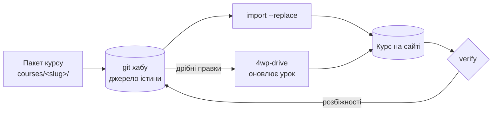

# Формат курсу (хаб → LMS4WP)

Контракт між хабом `~/4wp-publish-hub/LMS4WP/courses/` і імпортом LMS4WP (ADR 0005). Зразок — `courses/git-basics/`.

## Флоу



1. Пакет курсу закомічений у хабі.
2. `import --replace` — стерти курс на сайті й імпортувати заново.
3. `verify` — сайт = пакет.
4. Дрібні правки — у git, на сайт — через 4wp-drive (за `_lms4wp_source`).

## Структура

```
courses/<course-slug>/
├── meta.json                    → пакет 4wp-drive (ADR 0007)
├── course-structure.md          → Курс (lms_course)
└── module-<N>-<slug>/           → Модуль (lms_module, post_parent = курс, ADR 0008)
    ├── requirements.md          → пост модуля: title, опис, мета (type: module)
    ├── lesson-plan.md           → не імпортується
    ├── terminal.json            → термінал чаптера (мета модуля _lms4wp_terminal, ADR 0006)
    └── lesson-<N>-<M>-<slug>.md → Урок (lms_lesson)
```

## meta.json (пакет 4wp-drive)

```json
{
  "schema": 1,
  "package":  { "id": "git-basics", "lang": "uk", "author": "…", "type": "lms-course", "series": "Git" },
  "original": { "file": "course-structure.md", "role": "import", "post_type": "lms_course" }
}
```

Після імпорту Drive дописує `original` (`status`, `post_id`, …), LMS4WP — `lms`:

```json
"lms": { "state": "done", "course_id": 3552, "lessons": { "module-1-basics/lesson-1-1-what-is-vcs.md": 3553 },
         "commit": "773843d", "verify": "ok", "errors": [], "finished_at": "…" }
```

Імпорт на порталі: 4wp-drive Inbox → пакет курсу → тип «Course» → Import. Далі фонова черга (Action Scheduler): курс → модулі → `verify`.

## Front-matter

```yaml
---
title: "Урок 1.1. …"
slug: "lesson-1-1-…"
type: course | lesson | draft-note
category: "Module N"
level: "Beginner"            # → lms_level (Beginner / Intermediate / Advanced)
tags: ["git", "vcs"]         # → lms_tag
status: draft
---
```

`level` і `tags` — для курсу (`course-structure.md`) і уроків. Показуються в шаблонах курсу й уроку.

Лише для курсу: `guest_lessons: 3` — скільки перших уроків відкрито без входу (ADR 0003) → `_lms4wp_guest_lessons`. Без поля — значення з налаштувань курсу (за замовчуванням 1).

## Відповідність

| Хаб | LMS4WP | Правило |
|---|---|---|
| `<course-slug>` (тека) | `lms_course.post_name` | |
| `course-structure.md` → `title` | `post_title` курсу | частина до ` — ` |
| `course-structure.md` → тіло | `post_content` курсу | Markdown → блоки, без H1 |
| `module-<N>-<slug>` (тека) | ключ модуля | номер `N` — порядок |
| `requirements.md` → `title` (`type: module`) | `lms_module.post_title` | чиста назва (`Основи Git`); старий формат «Модуль N. … — вимоги» теж розбирається |
| `requirements.md` → `## Мета модуля` | `lms_module.post_excerpt` | перший абзац; тіло файлу → `post_content` модуля |
| `lesson-*.md` → `title` | `post_title` уроку | |
| `<course-slug>-` + `slug` | `post_name` уроку | префікс — від колізій між курсами |
| `lesson-*.md` → тіло | `post_content` уроку | Markdown → блоки, без H1 |
| `N`, `M` з імені файлу | `menu_order`, `_lms4wp_order` | `N * 100 + M` |
| `status` | `post_status` | `draft` → `draft`; перевизначається `--status` |

## Мета-ключі

| Ключ | Де | Значення |
|---|---|---|
| `_lms4wp_source` | курс, урок | шлях відносно `courses/` — ключ для повторного імпорту |
| `_lms4wp_source_hash` | курс, урок | sha1 файлу — пропуск незмінених, `verify` |
| `_lms4wp_source_commit` | курс | коміт хабу; `-dirty` / `uncommitted` — якщо є незакомічені зміни |
| `_lms4wp_module_key` | модуль | ключ теки (`module-1-basics`) |
| `_lms4wp_terminal` | модуль | `terminal.json` чаптера |
| `_lms4wp_course_id` | урок | ID курсу (наявний ключ) |
| `lms_module_tax` | урок | термін модуля (тіньова таксономія, ADR 0008) |
| `_lms4wp_order` | урок | порядок (наявний ключ) |
| `lms_level`, `lms_tag` | курс, урок | таксономії з front-matter `level`, `tags` |

## Секції уроку

Шаблон уроку в хабі однаковий: `Мета`, `Ключові поняття`, `Команди / артефакти`, `Типові помилки`, `Практичне завдання`, `Питання з інтерв'ю`.

### Практичне завдання → термінал чаптера (ADR 0006)

В уроці — лише тег:

````markdown
```terminal
```
````

→ блок `lms4wp/lesson-terminal` → `forwp-advanced-code/terminal` з профілем `lms4wp-lesson-<ID>`, зібраним з `terminal.json` модуля:

```json
{
  "version": 1,
  "title": "git — Модуль 1. Основи Git",
  "prompt": "$",
  "welcome": "Привітання за замовчуванням",
  "commands": [
    { "command": "git status", "slug": "status", "output": "On branch main…", "tip": "…" },
    { "pattern": "git add", "slug": "add", "output": "…" }
  ],
  "lessons": {
    "lesson-1-2-three-states": { "welcome": "Практика 1.2 — …", "commands": ["status", "add"] }
  }
}
```

- `commands` — формат профілю 4wp-advanced-code (`command` або `pattern`, непорожній `output`).
- Сценарій зі станом (модуль 1 — зразок): `state` (початковий стан), `persist: "session"`, у командах — `pattern` зі змінними `{value}`, `example`, `variants` з `when`, `set`, `reset`. Пам'ять спільна для всіх уроків розділу (`stateKey` = курс + модуль). Формат — `4wp-advanced-code/docs/hooks.md`.
- Ключ у `lessons` — ім'я файлу уроку без `.md`.
- Сайдбар: «This lesson» — команди уроку, «Chapter» — решта; працюють усі команди чаптера.
- ```` ```terminal ```` з `profile: <slug>` — звичайний профіль 4wp-advanced-code (без чаптера).

### Практичне завдання з кодом → IDE чаптера (ADR 0010)

В уроці — лише тег:

````markdown
```ide
```
````

→ блок `lms4wp/lesson-ide` → `forwp-advanced-code/ide` з `practice: lms4wp-lesson-<ID>`, задачі — з `ide.json` модуля:

```json
{
  "title": "WooCommerce — Модуль 1",
  "lessons": {
    "lesson-1-2-crud-data-stores": {
      "tasks": [
        {
          "file": "order-note.php",
          "title": "Мета замовлення через CRUD",
          "starter": "<?php\nadd_action( 'woocommerce_order_status_completed', function ( $order_id ) {\n\t// ...\n} );\n",
          "steps": [
            { "kind": "read", "title": "Задача", "body": "Прочитайте _delivery_slot замовлення так, щоб код працював з HPOS." },
            {
              "kind": "practice",
              "title": "Напишіть код",
              "body": "Отримайте замовлення і прочитайте мета.",
              "check": {
                "hook": "woocommerce_order_status_completed",
                "must": [
                  { "text": "wc_get_order(", "hint": "Отримайте об'єкт: wc_get_order( $order_id )." },
                  { "regex": "->get_meta\\(\\s*['\"]_delivery_slot", "hint": "Читайте через $order->get_meta( '_delivery_slot' )." }
                ],
                "must_not": [
                  { "regex": "\\bget_post_meta\\s*\\(", "hint": "get_post_meta() не бачить HPOS-таблиці." }
                ],
                "success": "Так. Код працює і з wp_posts, і з HPOS."
              }
            },
            { "kind": "done", "title": "Готово" }
          ]
        }
      ]
    }
  }
}
```

- Ключ у `lessons` — ім'я файлу уроку без `.md`; кілька `tasks` — по черзі (Next task).
- `kind`: `read`, `example` (`code` + «Load example»), `practice` (`check`), `quiz` (`options`, `feedback`), `done`.
- `check`: `function`, `hook`, `returns`, `must` / `must_not` (рядок або `{ text | regex, hint, output, raw }`; `raw: true` — шукати і в коментарях, напр. заголовки плагіна), `success`. Коментарі в коді учня не враховуються. PHP не виконується.
- Вимоги ADR 0009 діють і тут: імена файлів і функцій — ті самі, що в тексті «Практики».
- `run` задачі — симуляція кнопки Run (PHP не виконується): `output` — вивід при успіху; `functions` — відомі функції задачі (виклик зі схожою назвою → `PHP Fatal error: Call to undefined function`). Непройдені правила `check` → рядки `✗` (`output` правила або `hint`).

### Код-блоки

Мова — з fence (```` ```bash ````; `sh`/`shell`/`zsh` → `bash`, `js` → `javascript`, …). Без мови або невідома — `plaintext`. Автовизначення 4wp-advanced-code не використовується.

### Питання з інтерв'ю → FAQ (4wp-faq)

```markdown
## Питання з інтерв'ю

### Питання?
Відповідь (будь-які блоки до наступного ### / ##).
```

→ `forwp/faq` + core accordion. Категорія FAQ: `<курс>` › `<Модуль N. Назва>` (slug `<course>-<module-key>`), створюється при імпорті. Питання потрапляють у базу знань після сканування 4wp-faq (cron `forwp_faq_scan`).
Старий формат (список `- питання` без відповідей) лишається звичайним списком.

## Markdown

Підтримується: заголовки, абзаци, списки, код-блоки (```` ```lang ````), таблиці, цитати, `---`; інлайн — `**жирний**`, `*курсив*`, `` `код` ``, `[посилання](url)`.

## Команди

```bash
wp lms4wp course import <path> [--replace] [--status=<draft|publish>] [--author=<user>] [--force] [--dry-run] [--queue]
wp lms4wp course status <slug>
wp lms4wp course verify <path>
```

- `--queue` — фоновий імпорт через Action Scheduler (як з Drive); прогрес — `status`.

- `--replace` — видаляє курс і його уроки на сайті (за `_lms4wp_source`), потім імпортує. Нові ID — лише до запуску курсу для студентів.
- `--status` — перевизначає `status` з front-matter.
- `--force` — оновлює і незмінені файли.
- `--dry-run` — лише показує, що буде зроблено.
- `verify` — нічого не пише; показує `missing`, `changed`, `orphan`, `course`, `module`, `modules`, `commit`. Код виходу 1 при розбіжностях.
