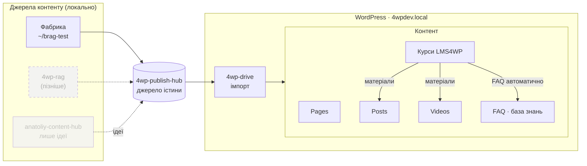
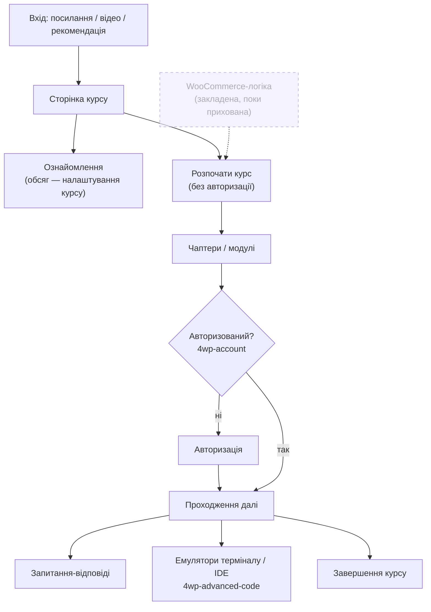

# Карта сайту і середовищ

Жива схема: доповнюється сутностями послідовно, за вказівкою автора.
Посилання в описах — на прод; уся робота — на локалі.

## Середовища

| Середовище | URL | Примітка |
|---|---|---|
| Прод | https://4wp.dev/ | лише для посилань |
| Локаль | https://4wpdev.local/ | робоче середовище; база — остання з проду |

## 1. Потік контенту

## 2. Шлях користувача (курс)

Поза MVP: AI-оцінювання, реальні репозиторії.

## Плагіни родини 4wp-*

| Плагін | Роль |
|---|---|
| LMS4WP | курси, чаптери, проходження |
| 4wp-account | авторизація користувача |
| 4wp-drive | імпорт контенту з хабу |
| 4wp-advanced-code | сніпети, емулятори терміналу й IDE |
| 4wp-faq | FAQ, база знань |
| 4wp-notifications | (уточнити роль у курсі) |
| 4wp-seo-helper | SEO |
| 4wp-social | (уточнити) |

## Сутності

| Сутність | Тип | Джерело |
|---|---|---|
| Pages | core `page` | |
| Posts | core `post` | хаб / матеріали з курсу |
| Videos | тема `4wpdev` (уточнити) | матеріали з курсу |
| Курс | LMS4WP | хаб: `4wp-publish-hub/LMS4WP/courses/<slug>/` |
| FAQ | 4wp-faq | автоматично з курсу |

Приклад курсу в хабі: `courses/git-basics/` — `struktura-kursu.md` + `modul-1…7`.

## Налаштування курсу

Що відкрито гостю (ознайомлення, скільки чаптерів без авторизації) — визначається в самому курсі.
